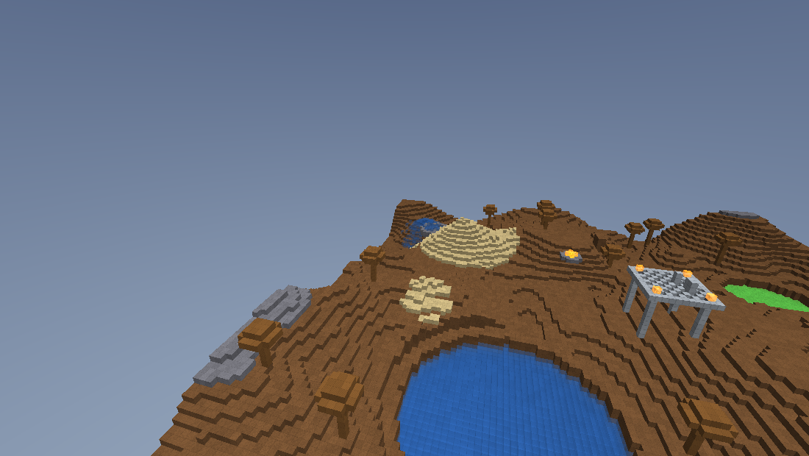

# Voxel Engine — C#

A desktop voxel engine skeleton in C#: 128³ world, data-driven voxel registry, a
falling-block/liquid simulation with five physics modes, an optional
multi-threaded tick, and a GPU raymarching renderer.

```
dotnet run                 # fly around
dotnet run -- --test       # headless test suite (65 checks)
dotnet run -- --bench      # measure the simulation
```

Requires the **.NET 8 SDK**. The only dependency is OpenTK (window + OpenGL
bindings), restored automatically.



---

## 1. Layout

```
VoxelEngine/
  Program.cs                 entry point: picks game / --test / --bench
  VoxelGame.cs               the window, the game loop, input, HUD   <- only file that knows OpenTK
  Engine/                    NO framework code at all — unit-testable
    Config.cs                every tunable number
    VoxelProperty.cs         the extension interface + example properties
    VoxelRegistry.cs         the ten voxel types and the palette
    World.cs                 storage, activity queue, THE PHYSICS RULES
    Schedulers.cs            serial tick + spatial-partitioned parallel tick
    WorldGenerator.cs        terrain, lake, oil pool, slime pit, dune, trees, metal rig
    Camera.cs                camera maths + the coordinate convention
    Player.cs                movement, dig, place
    VoxelRaycast.cs          DDA grid traversal for aiming
  Render/
    ShaderProgram.cs         compile/link/uniform cache
    VoxelRenderer.cs         the raymarching renderer + its GLSL
    HudRenderer.cs           flat coloured quads (hotbar, crosshair)
  Tools/HeadlessRender/      dev tool: renders frames with no window (see §10)
  Tests/EngineTests.cs       the test suite
```

The layer split matters: `Engine/` has no `using OpenTK`, which is why the whole
simulation can be tested in a container with no GPU and no display — and why
swapping the windowing library later touches three files, not thirty.

---

## 2. The ten voxel types

| # | key | name | viscosity | physics | transparency | temperature |
|---|-----|------|-----------|---------|--------------|-------------|
| 0 | `1` | Air | 0.00 | none | 1.00 | 20 |
| 1 | `2` | Dirt | 0.70 | **solid** | 0.00 | 20 |
| 2 | `3` | Water | 0.15 | **liquid** | 0.62 | 15 |
| 3 | `4` | Stone | 1.00 | fixable | 0.00 | 18 |
| 4 | `5` | Oil | 0.10 | **liquid** | 0.28 | 22 |
| 5 | `6` | Fire | 0.02 | none | 0.40 | 800 |
| 6 | `7` | Wood | 0.95 | none | 0.00 | 20 |
| 7 | `8` | Metal | 1.00 | none | 0.00 | 20 |
| 8 | `9` | Slime | 0.38 | **liquid** | 0.25 | 20 |
| 9 | `0` | Sand | 0.50 | **sand** | 0.00 | 24 |

---

## Current revision status

Liquid timers now requeue eligible liquid surfaces until their horizontal movement
is due. Before this fix, they could fall out of the active queue and never get
another chance to spread. Water, oil and slime use the original period in ticks;
with the tick rate halved, these intervals take twice as long in real time.

**Not implemented yet:** per-voxel velocities, gravity acceleration, relative-speed
collision thresholds, collision impulses, and moving chains. The current rules
below are still the old viscosity-only swap rules. Do not treat this build as
having the requested velocity system. Once chain movement is added it will need a
serial scheduler first: the old parallel slab scheduler assumes neighboring-cell
writes and cannot safely handle a chain that crosses a slab boundary.

The timings later in this document are historical, from the previous build;
rerun `--bench` for current timings.

## 3. The rules

Every tick, each *active* voxel is evaluated top to bottom and stops at the first
move it makes:

1. **falling, sand, liquid, or unsupported fixable** — fall straight down if the cell below is *less viscous* than me.
2. **`sand` + `liquid`** — otherwise, slide into a diagonal-below cell if it is
   less viscous.
3. **`liquid`** — otherwise, creep horizontally, but only every
   `viscosity × 100` ticks (`viscosity 0` ⇒ every tick). Oil 10, water 15,
   slime 38 ticks. A random direction is tried first, then the other three; it
   moves into the first one that is *less viscous*, and otherwise does not move.
4. **`fixable`** is held by a fixable voxel to a side or directly above; otherwise it falls like dirt. This local rule permits floating stone clusters.
5. **`none`** does not initiate movement; wood, metal, fire, and air can still be displaced by a swap when their viscosity allows it.

Moves **swap**, never overwrite: the mover takes the target cell and whatever was
there is pushed back into the vacated cell. Nothing is created or destroyed, so
total counts are conserved — the test suite asserts exactly that.

---

## 4. Decision log — the "why" behind each technique

### 4.1 A fixed timestep for physics, variable for rendering

`VoxelGame.OnUpdateFrame` accumulates real elapsed time and consumes it in fixed
`1/20 s` steps (previously `1/40 s`, so all tick-based physics runs at half the previous speed).

*Why:* if the simulation advanced by the frame delta, the world would behave
differently at 60 Hz and 144 Hz — liquids would spread different distances, and a
bug would be impossible to reproduce. A fixed step makes "one tick" a
well-defined unit you can count, replay, and later send to a server. The price is
that the sim can lag the display between ticks, which is why real engines
*interpolate* entity positions at render time. Our voxels snap to grid cells, so
there is nothing to interpolate yet — moving entities will need it.

Also note the two guards: a cap on ticks per frame (no death spiral) and dropping
a large backlog (coming back from a breakpoint shouldn't fast-forward 10 seconds
of simulation).

### 4.2 Data-oriented storage: the world is one `byte[]`

* One byte per voxel, holding the voxel **id** — not temperature, not a reference
  to an object.
* Flat index `x + PS*(y + PS*z)`: x fastest. So scanning x touches memory
  sequentially (cache-friendly), and the array can be uploaded to a 3D texture
  with no repacking.
* Everything derived from the id (viscosity, physics mode, liquid period) is
  *duplicated* into flat parallel arrays (`VoxelRegistry.Viscosity[id]`, etc.).
  One array lookup instead of pointer-chase + field read.
* The array is **padded by one voxel** on every side with permanent stone. That
  one decision removes all bounds checking from the physics kernel (a 3×3×3
  neighbourhood lookup can never leave the array) and doubles as bedrock so
  nothing can fall out of the world or leak off the edge.

*Why this shape:* a voxel game touches millions of voxels per second, and at that
scale the CPU is not "computing", it is **waiting for memory**. Objects scattered
around the heap mean a cache miss per voxel; a packed byte array means ~64 voxels
arrive per cache line. This is the single biggest reason the C# port runs at
~20 M voxel-updates/sec where the JS version managed ~4 M.

*The cost:* this layout is rigid. Adding "temperature" to every voxel cannot go
in that byte without eating id space — which is what §8 is about.

### 4.3 The active set: a settled world must cost nothing

The engine never scans the world to find work. Voxels that might need to act are
pushed onto a queue; anything that changes (a move, a player edit) wakes the
3×3×3 neighbourhood around it for the **next** tick.

Three consequences, all good:
* A quiet world costs **0.0001 ms per tick** (measured) — the loop is empty.
* Falling happens at exactly one cell per tick, because a wake-up during a tick
  lands in the *next* queue. Cascades are automatically rate-limited.
* A voxel can never be simulated twice in one tick, so no feedback loops.

*The cost:* if you forget to wake something up, it sleeps forever. Every mutation
must go through `World.Set`/`Touch` — this is the rule to remember when you add
features.

### 4.4 Deterministic hash-based randomness

Liquid direction is chosen by `Rng.Hash(voxelIndex, tick)` — a stateless hash, not
`Random`.

*Why:* a shared `Random` object is mutable state. Two threads would corrupt it,
and the same world would simulate differently every run, making bugs
unreproducible. Hashing the index with the tick gives the same answer for the
same voxel on the same tick, on any thread, forever, with zero synchronisation.
`--test` verifies that two identically-seeded worlds are byte-identical after 200
ticks.

### 4.5 No objects per voxel (this is why C# structs matter)

2.1 M voxels × an object each = 2.1 M heap allocations, a GC pause in the middle
of a frame, and pointer chasing through the whole world. Hence: ids in a
`byte[]`, extra per-voxel state in parallel typed arrays (`VoxelChannel<T>`), and
properties that live once per *type* (10 objects), not per voxel.

C# makes this cheap: `struct` + `T[]` has no per-element overhead, unlike a
`List<MyClass>`. This is the main reason C# is a good fit here despite having a
GC.

### 4.6 Multithreading — what it is, what it costs, and why this is hard

**What it is.** A CPU core executes instructions one at a time. A modern machine
has 4–16 cores. A thread is an independent execution stream; threads run truly
in parallel on different cores. Using them means splitting work into pieces that
don't interfere.

**The catch: data races.** Two threads writing the same memory is not "50/50
which wins" — it is undefined behaviour, and it usually corrupts something
subtly. Our simulation is full of exactly that: two grains of sand can both want
to move into the same cell, and neighbours constantly touch the same regions.

**The two standard fixes, and what I did:**

| approach | how | cost |
|---|---|---|
| locks / atomics | make threads take turns on shared cells | a lock per voxel move destroys the speedup |
| **spatial partitioning** | give each thread exclusive ownership of a region of the world | boundary handling, plus split/merge overhead |

This engine uses spatial partitioning into Z-slabs (`Engine/Schedulers.cs`):

1. Bucket the tick's work list by slab (counting sort, O(n)).
2. Each thread simulates its slab but may only **write** inside it. A move that
   would cross into a neighbour's slab is refused and the voxel is remembered.
3. Those few refused voxels are retried serially afterwards, with full access.
   That is what makes the result match the serial reference.
4. Each thread collects wake-ups in its **own** sink; one short serial merge
   folds them back into the queue. No locks in the hot path at all.

**When it actually helps.** Measured here (2 cores):

| workload | serial | parallel |
|---|---|---|
| settled world | 0.0001 ms | — (falls back to serial) |
| ~5 k active voxels | 0.076 ms | 0.077 ms |
| ~309 k active voxels | 15.6 ms | 17.7 ms |

Parallel is *slower* on 2 cores, because splitting, merging and thread handoff
cost more than the microseconds of work saved — and this sandbox has only 2
cores. On 8 cores with a heavy tick you would see a real win; on a light tick you
would not. That is the honest answer to "should I multithread?": **measure, don't
assume**, and keep the single-threaded path as the correctness reference (the
test suite runs both and compares).

**Also note what partitioning forbids:** a property's `OnTick` may not call
`World.Set` during a parallel tick, because that writes outside the owned slab.
This constraint is inherent to multithreading, not an accident of my design.

**What I would thread first**, in order:
1. World generation / chunk meshing — embarrassingly parallel, no shared state.
2. Per-voxel stencil passes (heat, light) — partitionable the same way.
3. The physics tick — last, because of the interference above and because it is
   already fast.

### 4.7 Raymarching vs. meshing (the renderer decision)

This renderer uploads the whole world as a 3D texture and per pixel walks the
grid in a fragment shader.

*Why:* editing a voxel is one byte write, no mesh rebuild; transparency is
natural (no sorting, no alpha-order artifacts); no chunk build step to write.

*The cost:* per-pixel work scales with resolution and view depth, the whole world
must fit in VRAM, and it re-uploads 2.2 MB whenever anything changes. It is a
great fit at 128³ and it is **the thing that must change before a big world** —
see §9. Minecraft-style meshing costs per visible *face* instead, which is why it
scales to huge worlds.

### 4.8 Why OpenTK and not Unity / Godot / MonoGame

You said you want to make the game eventually and that you're learning how games
work. Those two pull in opposite directions:

* **Unity / Godot** would give you an editor, physics, audio, asset pipeline and
  shipping for free — but they'd also hide the game loop, the renderer, and the
  simulation, which is exactly what you asked to learn.
* **OpenTK** is bare: a window, an OpenGL context, and input. Everything else you
  see here is explicit, ~1000 lines you can read end to end.
* **MonoGame** is the middle ground (XNA-style framework, good ship story) and is
  a fine next step if boilerplate starts to annoy you.

The `Engine/` folder is framework-free, so moving to any of them means rewriting
`VoxelGame.cs` + the two render classes — not the simulation.

### 4.9 The camera convention (and the "it's flipped" bug report)

The convention is defined in exactly one place, `Engine/Camera.cs`:

```
right-handed world: +X right, +Y up, +Z toward the viewer
yaw = pitch = 0        -> looking along -Z
right = (cos yaw, 0, sin yaw),  up = right × forward
screen NDC: x = +1 right edge, y = +1 top edge
```

Three independent checks exist, because "is it flipped?" is a question that
should be answered by a test and not by squinting:

1. `EngineTests.CameraConventionTests` — asserts a point at +X projects to
   `ndc.x > 0` (right), +Y projects to `ndc.y > 0` (top), moving the mouse right
   turns the view right, and that `Project()` is the exact inverse of
   `ScreenRay()`.
2. `Tools/HeadlessRender --markers` — renders orange/green/grey/tan markers at
   known offsets and reads back real pixels, so the *shader's* copy of the
   convention is checked too:

   ```
   PASS  orange (fire) is to the RIGHT of green (slime): x 528.0 vs 311.9
   PASS  white (metal) is in the UPPER half: y 89.8 < 225
   PASS  tan (sand) is in the LOWER half: y 234.8 > 225
   CAMERA CONVENTION OK
   ```
3. The rendered world view: sky is up, ground is down, no mirroring.

If the controls still *feel* inverted to you, that is a preference, not a bug —
flip either axis with one line in `Config.cs`:

```csharp
public static bool InvertLookX = false;
public static bool InvertLookY = false;
```

---

## 5. Measured numbers (this machine, 2 cores)

| what | cost |
|---|---|
| world generation | 37 ms |
| settled world, per tick | 0.0001 ms |
| 309 k active voxels, per tick | 15.6 ms (≈20 M voxel-updates/s) |
| full-grid 6-neighbour stencil pass | 17.2 ms (2.2 M cells, 8.8 MB of floats) |
| full volume upload to GPU | 2.2 MB per change |

The stencil number is the important one for your roadmap: *one* per-voxel
property that needs a neighbour pass already costs more than a 60 fps frame
budget at 128³. That is why per-voxel state must be designed deliberately, not
added casually.

---

## 6. Adding a voxel type

```csharp
VoxelRegistry.Define(new VoxelDef {
    Name = "Mud", Color = new Vector3(0.29f, 0.23f, 0.16f),
    Transparency = 0f, Viscosity = 0.45f,
    Physics = PhysicsMode.Sand, Temperature = 12f, Pattern = 2,
    Properties = { new MyProperty() },
});
```

That is all: ids are palette indices, the renderer rebuilds its colour table
automatically, and the physics lookup tables update on registration.

## 7. Adding behaviour — the property interface

```csharp
public interface IVoxelProperty
{
    string Key { get; }
    void OnAttach(VoxelDef def) { }
    bool OnTick(World world, int index, VoxelDef def) => true;  // false = veto movement
    void OnPlaced(World world, int index, VoxelDef def) { }
    void OnRemoved(World world, int index, VoxelDef def) { }
    void OnFrame(VoxelDef def, double timeSeconds) { }
    Vector3? PaletteColor(VoxelDef def) => null;
    float? PaletteEmissive(VoxelDef def) => null;
}
```

Default interface implementations mean you implement only the hooks you need.
Two examples ship: `FlickerProperty` (animates fire's glow by mutating shared
render state) and `TemperatureProperty` (pure data carrier).

**The important limitation:** these live once per voxel *type*. If the state
varies per *voxel*, this is the wrong tool — use a channel:

```csharp
var temp = world.Channel<float>("temperature", 20f);   // one float per voxel
temp.Data[world.Index(x, y, z)] = 300f;
```

That is 8.8 MB at 128³ and is the pattern to use for temperature, damage,
moisture, anything. But read §5's stencil number before you simulate it.

---

## 8. Controls

| input | action |
|---|---|
| `W A S D` | fly horizontally (no collision yet) |
| `Space` / `Shift` | fly up / down |
| mouse | look (`Esc` releases the cursor, click re-grabs) |
| `LMB` | destroy voxel |
| `RMB` | place selected voxel |
| `1…9`, `0` | select voxel type in palette order |
| wheel | cycle voxel type |
| `P` | pause physics |
| `T` | toggle serial ↔ parallel scheduler |
| `R` | regenerate world |
| `F1` | print scheduler timings |

There is no text HUD (that needs a glyph atlas); live numbers are in the window
title and the console, and the hotbar is colour-coded.

---

## 9. Roadmap: what to change for what you want next

**Bigger worlds.** Two independent limits. (a) The renderer holds the whole
volume as one 3D texture — fine to ~512³ (134 MB), then you need chunks. (b)
Index arithmetic wants to stay in `int` (`2^31`), which caps a flat padded array
around 1290³. The migration is the standard one: split the world into 32³ chunks,
store each as its own padded array, keep a `Dictionary<(int,int,int), Chunk>`,
and mesh or raycast per chunk. The padding trick survives — pad *per chunk*, and
cross-chunk neighbour reads hit the neighbouring chunk's border. That is a real
refactor, and the time to do it is when you actually hit the limit, not before.

**Per-voxel properties.** Add channels (§7), then decide the update schedule
deliberately: not every property every tick — round-robin the grid in slices (1/8
of the world per tick) so the cost spreads out. This is the single most important
optimisation for a "living world".

**Multithreading.** Already measured and scaffolded. Thread worldgen and any
stencil passes first; the physics tick is the least rewarding target. Use
`Parallel.For` over independent work, keep a serial reference implementation, and
test that both produce the same population — as `--test` does.

**Collision and gravity for the player.** A swept AABB against the voxel grid
(the same DDA idea in 3D, stopping at the first solid cell) plus a velocity
integrator. This is the next gameplay thing I'd add.

**A text HUD.** Generate a glyph atlas once (any font baked to an image), then
draw textured quads through `HudRenderer`. ~100 lines and it unlocks debug
readouts.

---

## 10. Testing without a display

`dotnet run -- --test` runs 60 checks with no GPU: registry contract, indexing,
every physics mode in isolation, viscosity gating, the swap rule, world
generation, a 1200-tick stability run, conservation of voxel counts, camera
convention, determinism, and serial-vs-parallel equivalence.

`Tools/HeadlessRender` renders real frames using EGL surfaceless + Mesa's
software rasteriser — no window, no display, works in a container:

```
dotnet run --project Tools/HeadlessRender -- out.ppm 960 540
dotnet run --project Tools/HeadlessRender -- --markers      # camera orientation proof
```

The GLSL was also validated against a standalone compiler (`glslangValidator`),
so a shader typo can't reach you as a black screen.
